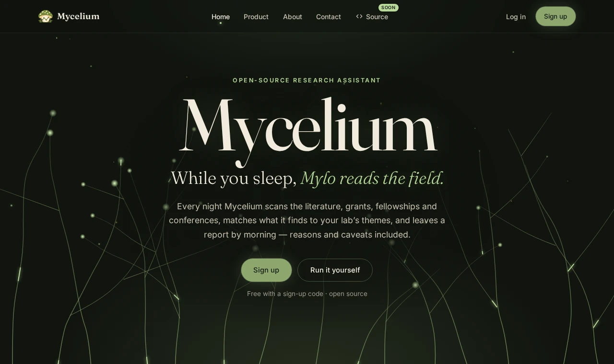
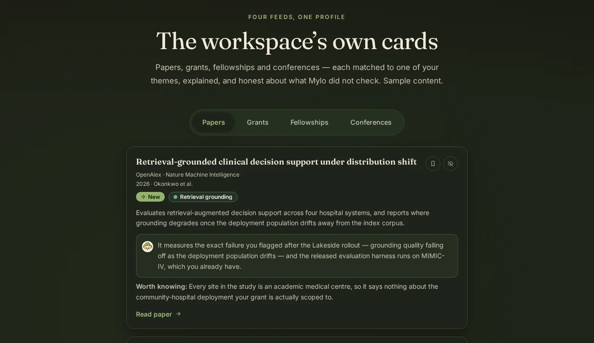
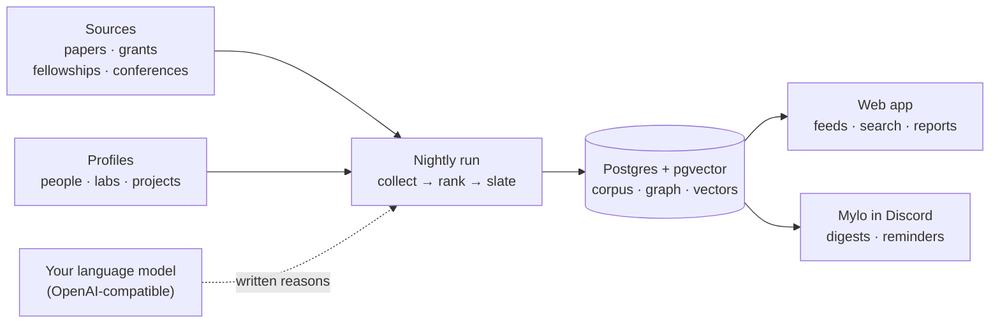

<p align="center">
  
</p>

<p align="center">
  <a href="LICENSE"></a>
  
  
</p>

<p align="center">
  <a href="https://mycelium.brendondgr.com"><b>Live site</b></a> ·
  <a href="#quickstart">Quickstart</a> ·
  <a href="docs/README.md">Docs</a> ·
  <a href="docs/research/">Research record</a> ·
  <a href="#roadmap">Roadmap</a>
</p>

<!-- The first sentence below is also the banner's tagline. If you change it,
     edit TAGLINE in ops/readme/make_header.py and re-run that script. -->
Mycelium is an open-source academic research assistant that any lab can run on
its own computers. It keeps a profile of your lab and its members, reads new
papers, grants, fellowships and conference calls every night, and leaves each
person and each lab a short report of what is worth their time, with the reason
written next to every item.

Underneath, Mycelium is a grounding layer: the paper and opportunity corpus, lab
and member profiles, a knowledge graph of who works on what, the recommendation
feeds, and an evaluation harness that measures retrieval quality. Research tools
are built on top of that layer. The feeds and reports are the first of them.

If you want to **use** it, start at [Quickstart](#quickstart). If you want to
**check the research**, start at [Research and evaluation](#research-and-evaluation).

**Contents:** [See it](#see-it) · [What it does today](#what-it-does-today) ·
[Quickstart](#quickstart) · [Configuration](#configuration) ·
[Day-to-day commands](#day-to-day-commands) · [How it's built](#how-its-built) ·
[Repository layout](#repository-layout) ·
[Research and evaluation](#research-and-evaluation) · [Roadmap](#roadmap) ·
[Documentation](#documentation) · [Contributing and license](#contributing-and-license)

## See it

Try the hosted instance at **[mycelium.brendondgr.com](https://mycelium.brendondgr.com)**.
Signing up there needs a sign-up code; to try it without one, run your own with
the [Quickstart](#quickstart). The screenshots below are from the public site and
show sample content for a fictional lab.

<p align="center">
  <a href="https://mycelium.brendondgr.com">
    
  </a>
</p>

**The morning report.** One written pass through the night, grouped by research
theme. Each item says where it sits in its theme, a verdict, and why it might not
be worth your time. Deadlines are flagged in gold.

<p align="center">
  
</p>

<details>
<summary><b>The feed cards</b>: papers, grants, fellowships and conferences</summary>
<br />
<p align="center">
  
</p>
</details>

## What it does today


- **Profiles.** Import a person's publications from OpenAlex, Semantic Scholar,
  Google Scholar or ORCID, optionally add a résumé, and Mycelium drafts themed
  research interests that the person edits and approves. Labs, departments and
  projects get profiles of their own.
- **Four feeds.** Research papers, grants, fellowships and conferences, each
  ranked for a person, a lab or a project, each item with a written reason it
  fits.
- **A daily report.** A sectioned morning briefing per person and per lab, in the
  app and as a PDF.
- **Deadlines and reminders.** Save an item and get reminded before its
  deadlines, in the app or in Discord.
- **Search** across the whole corpus, combining full-text, vector and fuzzy
  matching.
- **Mylo in Discord.** Mylo, Mycelium's mushroom-scout mascot, is also its
  Discord bot. It links accounts, posts lab digests and opportunity
  announcements, and answers `/mylo` slash commands.
- **Labs and departments.** Shared workspaces with roles, invitations,
  collaborative projects and reading lists.

Everything is self-hosted. The language model is any OpenAI-compatible endpoint
you point it at, such as a local vLLM or Ollama server or a hosted API, and the
embedding model runs on your CPU or GPU.

## Quickstart

You need Docker with the Compose plugin and Python 3. [uv](https://docs.astral.sh/uv/)
is needed only for the host tools: tests, the nightly run and the research record.

```bash
git clone https://github.com/brendondgr/Mycelium.git
cd Mycelium
make setup
```

`make setup` asks for your model endpoint, then:

1. writes `.env` with freshly generated secrets;
2. builds and starts the stack, and applies the database migrations;
3. creates the first admin account.

The first build takes several minutes. When it finishes, open
**http://localhost:11050** and sign in as `admin` with the `ADMIN_USER_PASS` from
`.env`. Anyone else signs up with the `SIGNUP_ACCESS_CODE` from the same file.

Agents and scripts can run `make setup` without a terminal. Pass the endpoint as
`LLM_BASE_URL`, `LLM_API_KEY` and `LLM_MODEL` in the environment and nothing is
asked.

## Configuration

Compose loads [`.env.example`](.env.example) first and your `.env` second, so
`.env` holds only what you change. Every variable is documented in
`.env.example`; these are the ones worth knowing on day one:

| Variable | What it does |
|---|---|
| `LLM_BASE_URL`, `LLM_API_KEY`, `LLM_MODEL` | The model behind profile drafting and the written reasons. Without a reachable endpoint, Mycelium falls back to deterministic drafts |
| `SIGNUP_ACCESS_CODE` | The code a new account must enter. Sign-up is invite-only |
| `ADMIN_USER_PASS` | The first admin's password, read by `make admin` |
| `PUBLIC_HOSTNAME` | Your domain, if you serve Mycelium beyond localhost |
| `EMAIL_ENABLED` | Off by default. Turn it on, with a Resend key, to send verification and invitation emails |

Mylo's Discord bot reads its token and channel ids from `.env-mylo`. While those
are blank, the bot stays off. Setup is described in
[`docs/discord-integration.md`](docs/discord-integration.md).

## Day-to-day commands

Every root command is a `make` target. `make help` lists them all.

| Command | What it does |
|---|---|
| `make up` / `make down` | Start or stop the stack. Starting waits for the API and applies migrations |
| `make restart` | A full reset: clears the frontend build caches and restarts Mylo last |
| `make build` | Rebuild the images, then start |
| `make status` | Container state, Mylo state, and the health of each endpoint |
| `make logs` | Follow the stack's logs |
| `make admin NAME=alice` | Create or promote an admin |
| `make nightly` | Run the nightly research pipeline once, now |
| `make test` / `make test-mylo` | The backend and the Mylo test suites |
| `make lint` | Astro check, Next.js eslint, backend ruff |
| `make gpu-up` | Start with CUDA embeddings (needs the nvidia-container-toolkit) |

Nginx serves everything from one origin, http://localhost:11050:

- the landing site at `/`
- the app at `/app`
- the API at `/api`
- Django admin at `/admin`

For frontend work with hot reload, `npm run dev` starts a development gateway on
the same port.

### The nightly run

`make nightly` runs [`ops/nightly/manual_all.py`](ops/nightly/manual_all.py).
It collects every source, re-ranks the whole corpus for every person, lab and
project, and reports only what newly entered each top slate. A written reason
is reused rather than regenerated, so a quiet night costs almost nothing in
model calls. To run it every morning, install the systemd units with
`sudo python3 ops/mycelium install-service`. That also starts the stack and
the Discord bot at boot.

## How it's built



Every night the run collects new items, ranks the whole corpus against each
profile, and keeps a top slate per research theme. Only items that newly enter a
slate are sent to the language model for a written reason. Everything lands in
Postgres, which the app and the Discord bot both read.

| Layer | Technology | Location |
|---|---|---|
| Public site | Astro 6, Tailwind v4 (no framework JavaScript shipped) | `web/landing/` |
| App | Next.js 16 (App Router), React 19, Tailwind v4, Radix UI | `web/app/` |
| API | Django 5 + Django REST Framework | `web/backend/` |
| Background jobs | Celery + Redis in the stack; the nightly run as a host systemd timer | `web/backend/`, `ops/nightly/` |
| Data | PostgreSQL 17 with pgvector, holding records, the knowledge graph and vectors alike | `postgres` service |
| Embeddings | fastembed / ONNX Runtime, CPU or CUDA | `web/backend/apps/scraper/embedding.py` |
| Language model | Any OpenAI-compatible endpoint | `web/backend/apps/core/llm.py` |
| Discord bot | discord.py | `mylo/` |
| Gateway | Nginx, single origin | `web/infra/nginx/` |

Neo4j and MinIO run in `compose.yaml` but nothing reads them. The graph lives in
Postgres, and files live on disk.

## Repository layout

```text
web/      the app: public site, authenticated app, Django API, Nginx config
mylo/     the Mylo Discord bot and the nightly run's error reporting
ops/      everything that runs on the host: stack manager, setup, nightly run,
          scrapers, systemd units, load test, research-record tooling
eval/     the retrieval evaluation harness
docs/     direction, architecture, the research record, the changelog
```

[`docs/repo-map.md`](docs/repo-map.md) maps every feature to the file that holds
it.

## Research and evaluation

Mycelium is also a research project, and its record lives in
[`docs/research/`](docs/research/):

- Every experiment, baseline and ablation, with its protocol, results and
  figures, is listed in [`INDEX.md`](docs/research/INDEX.md).
- What the project can and cannot claim is in
  [`CLAIMS.md`](docs/research/CLAIMS.md).
- The rules for recording a run are in
  [`AGENT_INSTRUCTIONS.md`](docs/research/AGENT_INSTRUCTIONS.md).

Retrieval quality is a regression suite. Any change to ranking is re-measured
with the harness in [`eval/`](eval/README.md):

```bash
uv run --project eval eval/run.py --config eval/configs/fusion_dense_pool.toml --collection sci-2026-train
```

Scaffold a new experiment with `make new-experiment SLUG=<slug>`, and check the
record with `make validate-research`.

## Roadmap

These tools are planned, not built. Each will read the lab's context from
Mycelium and be held to a public benchmark before it is called working. Details
are in [`docs/goals.md`](docs/goals.md#tools-on-the-grounding-layer).

- **A claim and citation-stance engine**, built alongside a hypothesis engine. It
  asks whether a later paper supports, disputes or only mentions a claim, and is
  scored on SciCite and MultiCite.
- **Systematic-review screening.** Ranks thousands of abstracts so reviewers read
  the likely includes first. Scored on CLEF TAR and SYNERGY as the work saved at
  95% recall.
- **An expertise finder.** Answers who works on a topic and which teams could
  go after a call. Scored by recovering held-out collaborations.
- **Literature-mined domain databases.** Structured facts pulled from papers at
  scale. Scored by precision against a curated database.
- **Internal funding and limited-submission matching.**

## Documentation

- Start at [`docs/README.md`](docs/README.md).
- Direction:
  - [`purpose.md`](docs/purpose.md)
  - [`goals.md`](docs/goals.md)
  - [`styles.md`](docs/styles.md)
- Reference:
  - [`architecture.md`](docs/architecture.md)
  - [`api-contract.md`](docs/api-contract.md)
- Guidance for coding agents:
  - [`CLAUDE.md`](CLAUDE.md)
  - [`docs/skills/`](docs/skills/index.md)

## Contributing and license

See [`CONTRIBUTING.md`](CONTRIBUTING.md) for the checks a change is expected to
pass and how experiments are recorded. Mycelium is released under the
[Apache License 2.0](LICENSE). See [`NOTICE`](NOTICE).
