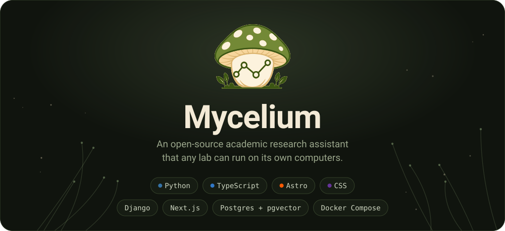
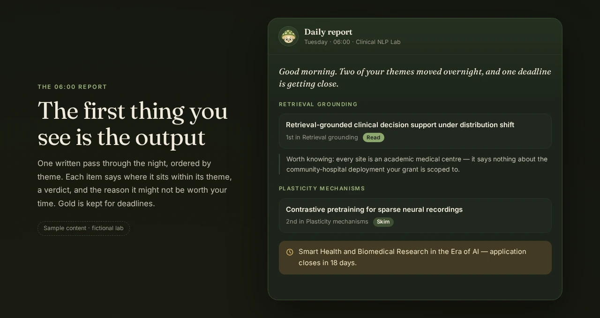
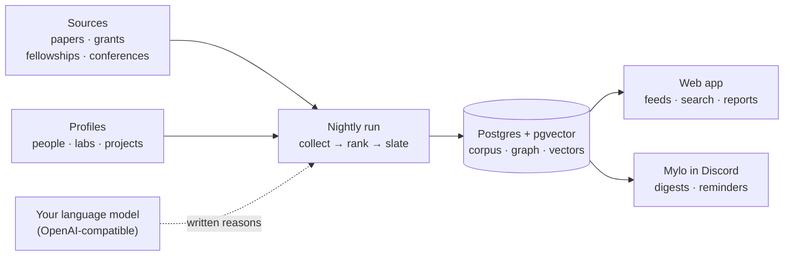

<p align="center">
  
</p>

<p align="center">
  <a href="LICENSE"></a>
  
  
</p>

<p align="center">
  <a href="https://mycelium.brendondgr.com"><b>Live site</b></a> ·
  <a href="#quickstart">Quickstart</a> ·
  <a href="docs/README.md">Docs</a> ·
  <a href="docs/research/">Research record</a> ·
  <a href="#roadmap">Roadmap</a>
</p>

<!-- The first sentence below is also the banner's tagline. If you change it,
     edit TAGLINE in ops/readme/make_header.py and re-run that script. -->
Mycelium is an open-source academic research assistant that any lab can run on
its own computers. It keeps a profile of your lab and its members, reads new
papers, grants, fellowships and conference calls every night, and leaves each
person and each lab a short report of what is worth their time, with the reason
written next to every item.

Underneath, Mycelium is a grounding layer: the paper and opportunity corpus, lab
and member profiles, a knowledge graph of who works on what, the recommendation
feeds, and an evaluation harness that measures retrieval quality. Research tools
are built on top of that layer. The feeds and reports are the first of them.

If you want to **use** it, start at [Quickstart](#quickstart). If you want to
**check the research**, start at [Research and evaluation](#research-and-evaluation).

**Contents:** [See it](#see-it) · [What it does today](#what-it-does-today) ·
[Quickstart](#quickstart) · [Configuration](#configuration) ·
[Day-to-day commands](#day-to-day-commands) · [How it's built](#how-its-built) ·
[Repository layout](#repository-layout) ·
[Research and evaluation](#research-and-evaluation) · [Roadmap](#roadmap) ·
[Documentation](#documentation) · [Contributing and license](#contributing-and-license)

## See it

Try the hosted instance at **[mycelium.brendondgr.com](https://mycelium.brendondgr.com)**.
Signing up there needs a sign-up code; to try it without one, run your own with
the [Quickstart](#quickstart). The screenshots below are from the public site and
show sample content for a fictional lab.

<p align="center">
  <a href="https://mycelium.brendondgr.com">
    
  </a>
</p>

**The morning report.** One written pass through the night, grouped by research
theme. Each item says where it sits in its theme, a verdict, and why it might not
be worth your time. Deadlines are flagged in gold.

<p align="center">
  
</p>

<details>
<summary><b>The feed cards</b>: papers, grants, fellowships and conferences</summary>
<br />
<p align="center">
  
</p>
</details>

## What it does today


- **Profiles.** Import a person's publications from OpenAlex, Semantic Scholar,
  Google Scholar or ORCID, optionally add a résumé, and Mycelium drafts themed
  research interests that the person edits and approves. Labs, departments and
  projects get profiles of their own.
- **Four feeds.** Research papers, grants, fellowships and conferences, each
  ranked for a person, a lab or a project, each item with a written reason it
  fits.
- **A daily report.** A sectioned morning briefing per person and per lab, in the
  app and as a PDF.
- **Deadlines and reminders.** Save an item and get reminded before its
  deadlines, in the app or in Discord.
- **Search** across the whole corpus, combining full-text, vector and fuzzy
  matching.
- **Mylo in Discord.** Mylo, Mycelium's mushroom-scout mascot, is also its
  Discord bot. It links accounts, posts lab digests and opportunity
  announcements, and answers `/mylo` slash commands.
- **Labs and departments.** Shared workspaces with roles, invitations,
  collaborative projects and reading lists.

Everything is self-hosted. The language model is any OpenAI-compatible endpoint
you point it at, such as a local vLLM or Ollama server or a hosted API, and the
embedding model runs on your CPU or GPU.

## Quickstart

You need Docker with the Compose plugin and Python 3.
[uv](https://docs.astral.sh/uv/) is optional: the stack and the first
collection run without it; the daily timer, the Discord bot, the tests and the
research record use it.

```bash
git clone https://github.com/brendondgr/Mycelium.git
cd Mycelium
make setup
```

`make setup` asks three things: who the instance is for (the profile), the
public hostname people will use (or local only), and the language model (a
server you run, a hosted API key, or none for now). Then it:

1. writes `mycelium.toml` for that profile — `personal`, `lab` (the default),
   `department` or `institution`;
2. writes `.env` (mode 0600) with every secret generated: the Django key, the
   Postgres and Redis passwords, the sign-up code;
3. builds and starts the production stack, and applies the database migrations;
4. creates the first admin, and prints its password once (it is stored
   nowhere; `make admin NAME=admin` sets a new one).

The first build takes several minutes. When it finishes, open
**http://localhost:11050** and sign in as `admin`. The overview shows a
"Getting started" checklist: connect a model (or carry on without one), run the
first collection (`make nightly`), fill in your profile, invite people, and
optionally add Mylo to Discord. On `lab`, people join through an invitation
from inside the app.

Setup never asks for `sudo`. What needs root, it prints at the end under
**"You need to run these yourself"**: the exact commands, why, and how to check
them. Usually that is the systemd timer that collects new papers and
opportunities every morning (`sudo python3 ops/mycelium install-service`).
`make status` repeats the list until it is done, and `make doctor` checks the
whole instance.

Agents and scripts can run `make setup YES=1` (or without a terminal) and
nothing is asked: the answers come from the environment — `PUBLIC_HOSTNAME`,
`LLM_BASE_URL`, `LLM_API_KEY`, `LLM_MODEL`, and `PROFILE=…`. With no model
named, the instance runs without one on purpose.

Nginx listens on `127.0.0.1` only. To serve your lab, put a TLS front end
(Caddy, certbot, a Cloudflare tunnel) in front of it and set `PUBLIC_HOSTNAME`;
[`docs/configuration.md`](docs/configuration.md) has a working example of each.
Upgrading an install from before 2026-11-12? Read its last section first.

### What it needs

A rough guide, not a measurement:

- **Memory:** 8 GB is enough for one lab; 16 GB is more comfortable while the
  app builds (`next build`) and the nightly run embeds a large batch.
- **Disk:** about 15 GB to start (images, the Python and Node environments,
  the models), plus the corpus and database, which grow with every night.
- **Models:** the embedding model (about 100 MB) downloads on the first
  collection into `data/models/`. A GPU is optional (`make gpu-up`); the CPU
  is fine for a lab.
- **A language model** is optional. Without one, collection, ranking, the feeds,
  search, saves, reminders and deadlines all work; Mylo's written reasons, the
  morning report's prose and profile drafting fall back to plain templates, and
  Mylo cannot answer questions. Any OpenAI-compatible server works (vLLM,
  Ollama, llama.cpp, LiteLLM), or a hosted API.

## Configuration

What your instance allows lives in **`mycelium.toml`**: who may sign up, whether
email is sent and verified, whether billing exists, how much each person and lab
may track, optional features, and a cap on nightly model calls. Out of the box
there are **no limits and no billing**; every limit is off until you give it a
number. Change it with one command, or let your own agent do it
([`docs/skills/configure.md`](docs/skills/configure.md)):

```bash
ops/mycelium config show                    # what is in effect, and why
ops/mycelium config set signup.mode open    # anyone who can reach it may join
ops/mycelium config set limits.clusters 6   # turn one limit on
ops/mycelium config validate
```

[`docs/configuration.md`](docs/configuration.md) explains every section and
profile. Secrets stay in `.env`, which Compose loads after
[`.env.example`](.env.example):

| Variable | What it does |
|---|---|
| `LLM_BASE_URL`, `LLM_API_KEY`, `LLM_MODEL` | The model behind profile drafting and the written reasons. Without a reachable endpoint, Mycelium falls back to deterministic drafts |
| `POSTGRES_PASSWORD`, `REDIS_PASSWORD` | Generated by `make setup`; compose refuses to start without them |
| `BIND_ADDR`, `NGINX_PORT` | Where nginx listens (`127.0.0.1:11050` by default) |
| `SIGNUP_ACCESS_CODE` | The shared code, if you choose `signup.mode = "code"` |
| `RESEND_API_KEY` / `EMAIL_HOST_PASSWORD` | Mail credentials, if `email.provider` is `resend` or `smtp` |
| `PUBLIC_HOSTNAME` | Your domain, if you serve Mycelium beyond localhost |

Mylo's Discord bot reads its token from `.env-mylo`. While that is blank, the
bot stays off. Setup is described in
[`docs/discord-integration.md`](docs/discord-integration.md).

## Day-to-day commands

Every root command is a `make` target. `make help` lists them all.

| Command | What it does |
|---|---|
| `make up` / `make down` | Start (production) or stop the stack. Starting waits for the API and applies migrations |
| `make dev` | The hot-reload stack instead: `next dev`, `astro dev`, `runserver` with DEBUG on |
| `make restart` | A full reset in the last mode: clears the frontend build caches, then starts |
| `make build` | Rebuild the images, then start |
| `make status` | Containers, endpoints, Mylo, and any step still waiting for an administrator |
| `make doctor` | Check the instance end to end; exits 1 with the reason and the fix |
| `make logs` | Follow the stack's logs |
| `make admin NAME=alice` | Create or promote an admin (prompts for, or generates, the password) |
| `make backup` / `make restore FILE=…` | Database, uploaded files and `mycelium.toml`, into `data/backups/` |
| `make nightly` | Run the nightly research pipeline once, now (the first collection, too) |
| `make test` / `make test-mylo` | The backend and the Mylo test suites |
| `make lint` | Astro check, Next.js eslint, backend ruff |
| `make gpu-up` | Start with CUDA embeddings (needs the nvidia-container-toolkit) |

Nginx serves everything from one origin, http://localhost:11050:

- the landing site at `/`
- the app at `/app`
- the API at `/api`
- Django admin at `/admin`

For frontend work with hot reload, `make dev` runs the same stack with the
development servers (or `npm run dev` starts a development gateway on the host).

### The nightly run

`make nightly` runs [`ops/nightly/manual_all.py`](ops/nightly/manual_all.py).
It collects every source, re-ranks the whole corpus for every person, lab and
project, and reports only what newly entered each top slate. A written reason
is reused rather than regenerated, so a quiet night costs almost nothing in
model calls. Every stage runs inside the backend container, so it needs no
`uv` on the host; only the Illinois fellowship scrape, which drives a browser,
runs on the host and is skipped without `uv`. To run it every morning, install
the systemd units with `sudo python3 ops/mycelium install-service` (after
`uv sync`). That also starts the stack at boot, and the Discord bot once it has
a token.

## How it's built



Every night the run collects new items, ranks the whole corpus against each
profile, and keeps a top slate per research theme. Only items that newly enter a
slate are sent to the language model for a written reason. Everything lands in
Postgres, which the app and the Discord bot both read.

| Layer | Technology | Location |
|---|---|---|
| Public site | Astro 6, Tailwind v4 (no framework JavaScript shipped) | `web/landing/` |
| App | Next.js 16 (App Router), React 19, Tailwind v4, Radix UI | `web/app/` |
| API | Django 5 + Django REST Framework | `web/backend/` |
| Background jobs | Celery + Redis in the stack; the nightly run as a host systemd timer | `web/backend/`, `ops/nightly/` |
| Data | PostgreSQL 17 with pgvector, holding records, the knowledge graph and vectors alike | `postgres` service |
| Embeddings | fastembed / ONNX Runtime, CPU or CUDA | `tools/retrieval/embedding.py` |
| Language model | Any OpenAI-compatible endpoint | `web/backend/apps/core/llm.py` |
| Discord bot | discord.py | `mylo/` |
| Gateway | Nginx, single origin | `web/infra/nginx/` |

Neo4j and MinIO run in `compose.yaml` but nothing reads them. The graph lives in
Postgres, and files live on disk.

## Repository layout

```text
web/      the platform: public site, authenticated app, Django API, Nginx config
tools/    the research tools, one self-contained folder each: retrieval (the
          corpus), recommendation (ranking against profiles), delivery (feeds,
          reports, reminders, announcements) — see tools/README.md
mylo/     the Mylo Discord bot and the nightly run's error reporting
ops/      everything that runs on the host: stack manager, setup, nightly run,
          systemd units, load test, research-record tooling
eval/     the retrieval evaluation harness
docs/     direction, architecture, the research record, the changelog
```

A new research tool starts with `make new-tool NAME=<name>`; `make tools-check`
shows which tools loaded and why any did not.

[`docs/repo-map.md`](docs/repo-map.md) maps every feature to the file that holds
it.

## Research and evaluation

Mycelium is also a research project, and its record lives in
[`docs/research/`](docs/research/):

- Every experiment, baseline and ablation, with its protocol, results and
  figures, is listed in [`INDEX.md`](docs/research/INDEX.md).
- What the project can and cannot claim is in
  [`CLAIMS.md`](docs/research/CLAIMS.md).
- The rules for recording a run are in
  [`AGENT_INSTRUCTIONS.md`](docs/research/AGENT_INSTRUCTIONS.md).

Retrieval quality is a regression suite. Any change to ranking is re-measured
with the harness in [`eval/`](eval/README.md):

```bash
uv run --project eval eval/run.py --config eval/configs/fusion_dense_pool.toml --collection sci-2026-train
```

Scaffold a new experiment with `make new-experiment SLUG=<slug>`, and check the
record with `make validate-research`.

## Roadmap

These tools are planned, not built. Each will read the lab's context from
Mycelium and be held to a public benchmark before it is called working. Details
are in [`docs/goals.md`](docs/goals.md#tools-on-the-grounding-layer).

- **A claim and citation-stance engine**, built alongside a hypothesis engine. It
  asks whether a later paper supports, disputes or only mentions a claim, and is
  scored on SciCite and MultiCite.
- **Systematic-review screening.** Ranks thousands of abstracts so reviewers read
  the likely includes first. Scored on CLEF TAR and SYNERGY as the work saved at
  95% recall.
- **An expertise finder.** Answers who works on a topic and which teams could
  go after a call. Scored by recovering held-out collaborations.
- **Literature-mined domain databases.** Structured facts pulled from papers at
  scale. Scored by precision against a curated database.
- **Internal funding and limited-submission matching.**

## Documentation

- Start at [`docs/README.md`](docs/README.md).
- Direction:
  - [`purpose.md`](docs/purpose.md)
  - [`goals.md`](docs/goals.md)
  - [`styles.md`](docs/styles.md)
- Reference:
  - [`configuration.md`](docs/configuration.md) — running your own instance
  - [`architecture.md`](docs/architecture.md)
  - [`api-contract.md`](docs/api-contract.md)
- Guidance for coding agents:
  - [`CLAUDE.md`](CLAUDE.md)
  - [`docs/skills/`](docs/skills/index.md)

## Contributing and license

See [`CONTRIBUTING.md`](CONTRIBUTING.md) for the checks a change is expected to
pass and how experiments are recorded. Mycelium is released under the
[Apache License 2.0](LICENSE). See [`NOTICE`](NOTICE).
