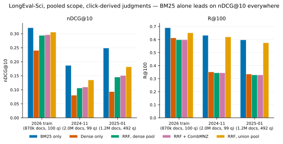
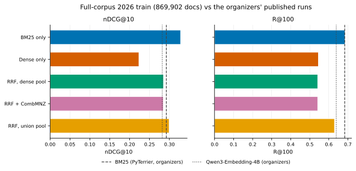

# EXP-2026-08-001 — Results

## 1. Headline

**The hypothesis did not survive.** BM25 alone outranks every fusion arm on
nDCG@10 on all three LongEval-Sci snapshots — the exact result named in advance
as the falsifier. The deployed configuration (`fusion_dense_pool`) scores nDCG@10
0.2937 on the 2026 training snapshot where plain BM25 scores 0.3212, and the gap
widens on the 2025 pair.

The implementation is not the problem: our BM25 (0.3282 full-corpus) **beats the
organizers' published PyTerrier BM25** (0.2922) on the same snapshot and qrels,
and their 4B-parameter dense baseline (0.2820) also loses to BM25. The dense
channel underperforms because of what this task is, not only because of which
embedder is in it.

## 2. Results table

Generated by `data/build_metrics.py` from `eval/results/*.json`. Every row is a
single deterministic run (n=1) — see the manifest note on why no variance is
reported. ⚠️ marks a run whose working tree was dirty.

<!-- BEGIN GENERATED TABLE -->

| Snapshot | Scope | Arm | Pool | Docs | Q | nDCG@10 | nDCG@100 | AP | R@100 | RR | P@10 | Run |
|---|---|---|---:|---:|---:|---:|---:|---:|---:|---:|---:|---|
| `longeval-sci-2026/snapshot-1/train` | full | `bm25_only` | — | 869,902 | 100 | 0.3282 | 0.4340 | 0.2796 | 0.6854 | 0.4843 | 0.2110 | `de31887` |
| `longeval-sci-2026/snapshot-1/train` | full | `dense_only` | — | 869,902 | 100 | 0.2234 | 0.3162 | 0.1754 | 0.5456 | 0.3846 | 0.1590 | `5b66bc2` |
| `longeval-sci-2026/snapshot-1/train` | full | `fusion_dense_pool` | 100 | 869,902 | 100 | 0.2852 | 0.3549 | 0.2190 | 0.5419 | 0.4505 | 0.1980 | `5b66bc2` |
| `longeval-sci-2026/snapshot-1/train` | full | `fusion_full` | 100 | 869,902 | 100 | 0.2849 | 0.3563 | 0.2233 | 0.5419 | 0.4545 | 0.1960 | `5b66bc2` |
| `longeval-sci-2026/snapshot-1/train` | full | `fusion_union_pool` | 100 | 869,902 | 100 | 0.2993 | 0.4031 | 0.2519 | 0.6299 | 0.4734 | 0.1960 | `5b66bc2` |
| `longeval-sci-2026/snapshot-1/train` | full | `BM25 (PyTerrier, organizers)` | — | — | 100 | 0.2922 | 0.4123 | 0.2573 | 0.6836 | 0.4717 | 0.1950 | _published_ |
| `longeval-sci-2026/snapshot-1/train` | full | `Qwen3-Embedding-4B (organizers)` | — | — | 100 | 0.2820 | 0.3919 | 0.2378 | 0.6390 | 0.4389 | 0.1880 | _published_ |
| `longeval-sci-2026/snapshot-1/train` | pooled | `bm25_only` | — | 84,489 | 100 | 0.3212 | 0.4314 | 0.2760 | 0.6903 | 0.4788 | 0.2100 | `de31887` |
| `longeval-sci-2026/snapshot-1/train` | pooled | `dense_only` | — | 84,489 | 100 | 0.2401 | 0.3498 | 0.1965 | 0.6120 | 0.4067 | 0.1700 | `de31887` |
| `longeval-sci-2026/snapshot-1/train` | pooled | `fusion_dense_pool` | 100 | 84,489 | 100 | 0.2937 | 0.3829 | 0.2360 | 0.5988 | 0.4589 | 0.2010 | `de31887` |
| `longeval-sci-2026/snapshot-1/train` | pooled | `fusion_dense_pool` | 1000 | 84,489 | 100 | 0.2915 | 0.4191 | 0.2577 | 0.7021 | 0.4607 | 0.1910 | `de31887` |
| `longeval-sci-2026/snapshot-1/train` | pooled | `fusion_full` | 100 | 84,489 | 100 | 0.2963 | 0.3859 | 0.2415 | 0.5988 | 0.4684 | 0.2020 | `de31887` |
| `longeval-sci-2026/snapshot-1/train` | pooled | `fusion_full` | 1000 | 84,489 | 100 | 0.2968 | 0.4221 | 0.2614 | 0.6996 | 0.4753 | 0.1930 | `de31887` |
| `longeval-sci-2026/snapshot-1/train` | pooled | `fusion_union_pool` | 100 | 84,489 | 100 | 0.3056 | 0.4129 | 0.2562 | 0.6511 | 0.4686 | 0.2020 | `de31887` |
| `longeval-sci-2026/snapshot-1/train` | pooled | `fusion_union_pool` | 1000 | 84,489 | 100 | 0.3001 | 0.4292 | 0.2665 | 0.7065 | 0.4645 | 0.2000 | `de31887` |
| `longeval-sci/2024-11` | full | `bm25_only` | — | 2,014,265 | 99 | 0.1841 | 0.3319 | 0.1949 | 0.6332 | 0.3239 | 0.1596 | `de31887` |
| `longeval-sci/2024-11` | pooled | `bm25_only` | — | 69,141 | 99 | 0.1869 | 0.3337 | 0.1985 | 0.6322 | 0.3277 | 0.1636 | `de31887` |
| `longeval-sci/2024-11` | pooled | `dense_only` | — | 69,141 | 99 | 0.0804 | 0.1675 | 0.0772 | 0.3518 | 0.2424 | 0.0717 | `de31887` |
| `longeval-sci/2024-11` | pooled | `fusion_dense_pool` | 100 | 69,141 | 99 | 0.1062 | 0.1842 | 0.0881 | 0.3449 | 0.2552 | 0.1020 | `de31887` |
| `longeval-sci/2024-11` | pooled | `fusion_dense_pool` | 1000 | 69,141 | 99 | 0.1298 | 0.2748 | 0.1273 | 0.5709 | 0.3017 | 0.1172 | `de31887` |
| `longeval-sci/2024-11` | pooled | `fusion_full` | 100 | 69,141 | 99 | 0.1098 | 0.1867 | 0.0903 | 0.3449 | 0.2617 | 0.1030 | `de31887` |
| `longeval-sci/2024-11` | pooled | `fusion_full` | 1000 | 69,141 | 99 | 0.1384 | 0.2828 | 0.1341 | 0.5680 | 0.3177 | 0.1192 | `de31887` |
| `longeval-sci/2024-11` | pooled | `fusion_union_pool` | 100 | 69,141 | 99 | 0.1350 | 0.2927 | 0.1315 | 0.6196 | 0.3121 | 0.1253 | `de31887` |
| `longeval-sci/2024-11` | pooled | `fusion_union_pool` | 1000 | 69,141 | 99 | 0.1410 | 0.3032 | 0.1413 | 0.6403 | 0.3169 | 0.1253 | `de31887` |
| `longeval-sci/2025-01` | full | `bm25_only` | — | 1,213,728 | 492 | 0.2362 | 0.3426 | 0.2181 | 0.5989 | 0.4054 | 0.1846 | `de31887` |
| `longeval-sci/2025-01` | pooled | `bm25_only` | — | 261,294 | 492 | 0.2486 | 0.3498 | 0.2280 | 0.5972 | 0.4199 | 0.1941 | `de31887` |
| `longeval-sci/2025-01` | pooled | `dense_only` | — | 261,294 | 492 | 0.0931 | 0.1660 | 0.0786 | 0.3348 | 0.1996 | 0.0736 | `de31887` |
| `longeval-sci/2025-01` | pooled | `fusion_dense_pool` | 100 | 261,294 | 492 | 0.1451 | 0.2010 | 0.1156 | 0.3294 | 0.2903 | 0.1118 | `de31887` |
| `longeval-sci/2025-01` | pooled | `fusion_dense_pool` | 1000 | 261,294 | 492 | 0.1656 | 0.2628 | 0.1463 | 0.4869 | 0.3221 | 0.1272 | `de31887` |
| `longeval-sci/2025-01` | pooled | `fusion_full` | 100 | 261,294 | 492 | 0.1506 | 0.2046 | 0.1187 | 0.3294 | 0.3002 | 0.1157 | `de31887` |
| `longeval-sci/2025-01` | pooled | `fusion_full` | 1000 | 261,294 | 492 | 0.1710 | 0.2678 | 0.1501 | 0.4915 | 0.3286 | 0.1315 | `de31887` |
| `longeval-sci/2025-01` | pooled | `fusion_union_pool` | 100 | 261,294 | 492 | 0.1819 | 0.3000 | 0.1635 | 0.5753 | 0.3442 | 0.1435 | `de31887` |
| `longeval-sci/2025-01` | pooled | `fusion_union_pool` | 1000 | 261,294 | 492 | 0.1840 | 0.3074 | 0.1695 | 0.5946 | 0.3424 | 0.1459 | `de31887` |

<!-- END GENERATED TABLE -->

> **Never compare across corpus scopes.** A `pooled` row re-ranks the judged set
> plus a lexical pool; a `full` row ranks the entire snapshot. Reordering metrics
> are broadly comparable, recall metrics are not.

## 3. Figures



**fig-arm-comparison** — nDCG@10 and R@100 per arm across all three snapshots,
pooled scope, matched pool width 100. BM25 leads on nDCG@10 in every snapshot.
Generated by `figures/make_figures.py`.



**fig-baseline-gap** — full-corpus 2026 training snapshot against the
organizers' published runs (dashed and dotted reference lines). Our BM25 clears
both published baselines; every fusion arm sits below the published BM25 line.
Generated by `figures/make_figures.py`.

## 4. Interpretation

**C-001 is partially supported and its practical implication is refuted.** Every
fusion arm beats `dense_only` **on nDCG@10** on every snapshot, so "fusion orders
better than vector retrieval alone" holds. But the claim as it functions in the
codebase — that hybrid fusion is the right default — does not: the simplest
possible baseline beats it everywhere. C-010 is recorded as **refuted** for
exactly this.

The ordering claim does not extend to recall. On `2024-11` pooled at pool width
100, `dense_only` reaches R@100 0.3518 and `fusion_dense_pool` only 0.3449 —
fusion is *worse* at finding documents than the dense channel it was built on,
because the lexical channel is confined to the dense pool and spends rank
positions reordering rather than adding. That is `EXP-2026-08-002`.

**The result is about the task, not about our code.** Two independent facts
separate the three usual explanations:

- *Implementation wrong?* No. Our BM25 beats the organizers' BM25 by 3.6 nDCG@10
  points on the same snapshot with the same scoring call.
- *Embedder too small?* Not sufficient as an explanation. A 4B-parameter dense
  model — an order of magnitude larger than our 384-dimension bge-small — also
  loses to BM25 here.
- *Task shape.* Short keyword queries over titles and abstracts are close to the
  best case for lexical matching and close to the worst case for dense
  retrieval. That is the reading the evidence supports.

**What this means for the product.** The deployed feed does not run keyword
queries; it runs declared-interest profiles, which is a different and probably
more dense-favourable shape. So this does not license ripping out the vector
channel. What it does license is the conclusion that **the lexical channel is
being wasted**: it currently reranks a dense-built pool and can never add a
document. That is measured separately in `EXP-2026-08-002`.

**Persistence (C-009) remains unanswered.** Across `2024-11` → `2025-01`,
full-corpus BM25 goes from nDCG@10 0.1841 to 0.2362 and R@100 0.6332 to 0.5989 —
no decay. But the two snapshots use *different topic sets* (99 vs 492 queries)
over differently sized corpora, so the comparison confounds elapsed time with
topic difficulty. It is evidence against catastrophic decay, not a measurement of
persistence.

## 5. Threats to validity

- **The judgments are click-derived pseudo-relevance**, not human assessment.
  Every number here inherits that ceiling, and a click model systematically
  favours what the original production system surfaced.
- **The task is not our task.** LongEval evaluates query → documents; Mycelium
  does declared-interest profile → feed. The granularity mismatch between a
  three-word interest and a 200-word abstract — a core difficulty of the real
  problem — is untested. This is the single largest threat and it is not
  fixable within this collection.
- **Pooled runs are re-ranking evaluations.** Their recall numbers do not
  transfer to a full corpus. The 2025 pair has no full-corpus dense or fusion
  arm at all, so its cross-arm comparison is pooled-only.
- **n=1 per cell.** Defensible here because the arms are deterministic, but it
  means there is no variance estimate and no significance test. Any claim of a
  *small* difference between two arms is unsupported; the BM25 gap is large
  enough to survive this, the gaps between fusion arms are not.
- **Fusion parameters are untuned.** RRF k=60 is inherited from the original RRF
  paper. BM25 as run here is also untuned. Neither side was tuned, so the
  comparison is fair, but neither is at its ceiling (Q-005).
- **Different snapshots, different query counts.** 100 / 99 / 492 queries. The
  2025-01 numbers rest on 5× the topics of the other two.

## 6. What surprised us

**The published dense baseline losing to BM25.** The expectation going in was
that our 384-dimension embedder was the weak link and a bigger model would close
the gap. A 4B-parameter model losing to BM25 on the same collection redirects the
diagnosis from "our model is small" to "this query type is not a dense-retrieval
problem" — which is a much more useful thing to know, and much cheaper than the
embedder swap it prevented.

**Our BM25 beating the organizers' BM25.** Not the expected direction for a
system with no IR specialist on it. It is the strongest available evidence that
the harness measures the production stack correctly rather than measuring a bug.

**The recall gap.** Not what the experiment was looking for. `fusion_union_pool`
outscoring `fusion_dense_pool` on R@100 by margins far larger than any nDCG@10
difference is the most actionable finding here, and a primary metric of nDCG@10
alone would have hidden it completely. It became `EXP-2026-08-002`.

## 7. Follow-ups

Recorded in [`../../OPEN_QUESTIONS.md`](../../OPEN_QUESTIONS.md):

- **Q-002** — does a stronger or domain-adapted embedder close the BM25 gap, or
  is the gap task shape?
- **Q-003** — is effectiveness genuinely persistent, or did the 2025 pair only
  look flat because the topic sets differ?
- **Q-004** — what does fusion cost in wall-clock and dollars relative to BM25 at
  equal effectiveness? (Per-run wall-clock is already recorded and shows the
  full-corpus `dense_only` arm at 25,509 s against `bm25_only` at 360 s.)
- **Q-005** — does RRF k=60 matter on this collection?
- **Q-001** (via `EXP-2026-08-002`) — does the recall gap survive on the
  production corpus?

## 8. Reproduction

```bash
# The runs (hours; the full-corpus dense arm alone is ~7 h of CPU embedding)
uv run --project eval eval/run.py --all --collection sci-2026-train
uv run --project eval eval/run.py --all --collection sci-2025-11
uv run --project eval eval/run.py --all --collection sci-2025-01
uv run --project eval eval/score_run.py

# This folder, from the run files (seconds)
cd docs/research/experiments/EXP-2026-08-001-longeval-retrieval-baseline
uv run --project ../../../../scripts/research python data/build_metrics.py
uv run --project ../../../../scripts/research python figures/make_figures.py
```

The second block regenerates `data/metrics.{csv,json}`, `tables/results.md`, the
table in this file, and both figures. It requires only the committed run files,
not the corpus.

## AMENDMENTS

_None._
