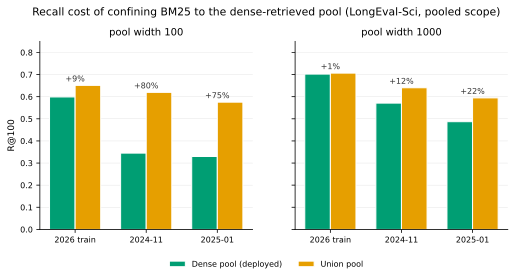

# EXP-2026-08-002 — Results

## 1. Headline

**The hypothesis survived, with a caveat that changes what to do about it.** At
the deployed pool width of 100, a union pool raises R@100 by **+8.7%** on the
2026 snapshot and by **+79.7%** and **+74.6%** on the 2025 pair — and it costs
nothing at the top of the ranking, since nDCG@10 also rises in all six cells. But
at pool width 1000 the gap mostly closes (+0.6%, +12.2%, +22.1%), so *deepening*
the pool substitutes for much of what *widening* it buys.

## 2. Results table

Generated by `data/build_metrics.py` from `EXP-2026-08-001`'s recorded runs.
Paired within snapshot and within pool width; n=1 per cell (deterministic arms).

<!-- BEGIN GENERATED TABLE -->

| Snapshot | Pool | Q | dense R@100 | union R@100 | **ΔR@100** | dense nDCG@10 | union nDCG@10 | ΔnDCG@10 |
|---|---:|---:|---:|---:|---:|---:|---:|---:|
| `2026 train` | 100 | 100 | 0.5988 | 0.6511 | **+8.7%** | 0.2937 | 0.3056 | +4.0% |
| `2026 train` | 1000 | 100 | 0.7021 | 0.7065 | **+0.6%** | 0.2915 | 0.3001 | +3.0% |
| `2024-11` | 100 | 99 | 0.3449 | 0.6196 | **+79.7%** | 0.1062 | 0.1350 | +27.1% |
| `2024-11` | 1000 | 99 | 0.5709 | 0.6403 | **+12.2%** | 0.1298 | 0.1410 | +8.7% |
| `2025-01` | 100 | 492 | 0.3294 | 0.5753 | **+74.6%** | 0.1451 | 0.1819 | +25.4% |
| `2025-01` | 1000 | 492 | 0.4869 | 0.5946 | **+22.1%** | 0.1656 | 0.1840 | +11.1% |

<!-- END GENERATED TABLE -->

Full precision and the secondary measures: [`data/metrics.csv`](data/metrics.csv).

## 3. Figures



**fig-pool-recall-gap** — R@100 for both pool constructions at both pool widths,
annotated with the relative gain. Two panels because the answer depends on pool
width; showing one would make the finding look either alarming or negligible, and
it is neither. Generated by `figures/make_figures.py`.

## 4. Interpretation

**C-008 is supported.** Confining BM25 to the dense-retrieved pool costs recall,
and the cost scales with how weak the dense channel is on that corpus. The 2025
pair, where `dense_only` scores R@100 0.35 and 0.33, shows the largest gaps; the
2026 snapshot, where the dense channel is much stronger (0.61), shows the
smallest. That is the predicted relationship, measured.

**The architectural criticism is correct but the fix is not the obvious one.**
The audit's reading — the lexical channel can reorder a document but never add
one, so C-001 is a reordering claim — is confirmed. The tempting conclusion is
"switch production to a union pool". The pool-width panel argues against
rushing: at width 1000 the dense pool recovers most of the gap on its own, so a
production change could plausibly be *pool depth* rather than *pool
construction*, and depth is a config change while construction is a rewrite.

**Nothing is lost at the top.** nDCG@10 rises in all six cells, so this is not a
recall-for-precision trade. That matters: a recall gain that pushed relevant
documents down the ranking would be useless to a product that shows ten items.

**The risk this quantifies is a silent one.** Dense-channel weakness is not
visible in a top-10 metric, so a corpus drifting away from what the embedder
handles well would degrade recall with no signal in the numbers anyone watches.
That is an argument for keeping R@100 on the dashboard, independent of which fix
is chosen.

## 5. Threats to validity

- **This ablation is post-hoc.** The union-pool arm existed as a comparison for
  `EXP-2026-08-001`; the recall gap was noticed in those results and the question
  written afterward. That is a real weakness — the analysis was not
  pre-registered — and it is why the follow-up (Q-001) is framed as a
  confirmation on a different corpus rather than as settled.
- **Pool width and pool construction interact**, and only two widths were run.
  The crossover between them is unmeasured, so "depth substitutes for width"
  is a description of two points, not a curve.
- **Pooled scope only.** These are re-ranking evaluations. The full-corpus 2026
  runs point the same way (`fusion_dense_pool` R@100 0.5419 vs
  `fusion_union_pool` 0.6299, +16.2%), but the 2025 pair has no full-corpus
  fusion arm, so the headline comparison could not be run at full scope.
- **Different collection, different task.** LongEval is keyword queries over
  titles and abstracts. The production feed runs declared-interest profiles over
  a different corpus, where the dense channel may be much stronger and the gap
  correspondingly smaller. Q-001 exists for exactly this.
- **n=1, no significance test.** The +8.7% cell is small enough that it should
  not be leaned on alone; the 75–80% cells are not.
- **Click-derived judgments.** A click model favours what the original production
  system surfaced, which plausibly under-credits documents *any* of these arms
  newly retrieves. If anything this biases the measured gains downward.

## 6. What surprised us

**How much of the gap pool depth closes.** The expectation was that union
pooling was strictly necessary and the deployed construction was simply wrong.
Instead, at width 1000 the 2026 gap is +0.6% — noise. The architectural
criticism is real, but it is much cheaper to mitigate than it looked, and that
reframes it from "rewrite the pool builder" to "measure the width you actually
need".

**That nDCG@10 improved too.** A recall intervention that also helps the top of
the ranking is not the usual shape. It suggests the dense pool was omitting
documents that were not merely additional but genuinely better, which is a
sharper criticism than the recall number alone.

## 7. Follow-ups

- **Q-001** — does the union pool's recall advantage survive on the production
  corpus, where documents are longer and queries are declared interests? This
  must be answered before changing the production pool builder on the strength of
  external evidence.
- **New:** measure R@100 across a sweep of pool widths on one snapshot, to find
  where depth stops substituting for width. This is cheap — pooled runs take
  seconds — and it decides whether the fix is a config value or a rewrite. Added
  to [`../../OPEN_QUESTIONS.md`](../../OPEN_QUESTIONS.md) as Q-006.

## 8. Reproduction

```bash
cd docs/research/experiments/EXP-2026-08-002-dense-pool-vs-union-pool
uv run --project ../../../../scripts/research python data/build_metrics.py
uv run --project ../../../../scripts/research python figures/make_figures.py
```

Reads `EXP-2026-08-001`'s `data/metrics.csv`, which is itself derived from
`eval/results/*.json`. Regenerating the underlying runs is documented in that
experiment's `RESULTS.md` §8.

## AMENDMENTS

_None._
