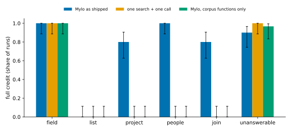

# EXP-2026-11-018 — Results

## 1. Headline

- **C-043 supported (narrowly):** Mylo earned full credit — every gold object cited, nothing wrong stated — on **108/150 = 0.72** answerable runs (question-bootstrap 95% [0.60, 0.84]; Wilson [0.64, 0.79]); first attempts only, exactly **0.70** [0.58, 0.82]. The lower bound sits below the bar.
- **C-044 supported:** Mylo minus one search + one call, per-question full credit **+0.42** (paired bootstrap 95% [+0.28, +0.55], 60 questions).
- **C-045 supported:** Mylo minus Mylo-with-corpus-functions-only on project, people and join questions **+0.87** [+0.73, +0.97] (30 questions), positive in each kind.
- **C-046 supported:** Mylo stated a fact on **0/30** unanswerable runs (Wilson upper 0.11). Nothing refuted. **No arm got any list question fully right (0/30 each).** Graded by code against stored facts. Not judged by people.

## 2. Results table

Full credit per kind, runs with full credit / runs (3 repetitions × 10 questions);
from `tables/summary.md`, generated by `code/grade.py` from `data/runs.jsonl`.
Primary grading: an object counts only when cited as `#n` and resolved to its
id. Secondary also accepts its name in the text.

<!-- BEGIN GENERATED TABLE -->
| grading | arm | field | list | project | people | join | unanswerable | answerable full (95% CI, questions bootstrap) | unanswerable states a fact |
|---|---|---|---|---|---|---|---|---|---|
| primary | a | 30/30 | 0/30 | 24/30 | 30/30 | 24/30 | 27/30 | 0.72 [0.6, 0.84] (n=150) | 0/30 [0.0, 0.1135] |
| primary | b | 30/30 | 0/30 | 0/30 | 0/30 | 0/30 | 30/30 | 0.2 [0.1, 0.32] (n=150) | 0/30 [0.0, 0.1135] |
| primary | c | 30/30 | 0/30 | 0/30 | 0/30 | 0/30 | 29/30 | 0.2 [0.1, 0.32] (n=150) | 0/30 [0.0, 0.1135] |
| secondary | a | 30/30 | 0/30 | 30/30 | 30/30 | 24/30 | 27/30 | 0.76 [0.64, 0.88] (n=150) | 0/30 [0.0, 0.1135] |
| secondary | b | 30/30 | 0/30 | 0/30 | 0/30 | 0/30 | 30/30 | 0.2 [0.1, 0.32] (n=150) | 0/30 [0.0, 0.1135] |
| secondary | c | 30/30 | 0/30 | 0/30 | 0/30 | 0/30 | 29/30 | 0.2 [0.1, 0.32] (n=150) | 0/30 [0.0, 0.1135] |
<!-- END GENERATED TABLE -->

Paired differences (per-question mean full credit, bootstrap over questions,
10,000 resamples, seed 20261115; all in `tables/summary.md`):

| comparison | primary | secondary |
|---|---|---|
| a − b, all 60 (C-044) | +0.4167 [+0.2833, +0.5500] | +0.4500 [+0.3167, +0.5833] |
| a − b, 50 answerable | +0.5200 [+0.3800, +0.6600] | +0.5600 [+0.4200, +0.7000] |
| a − c, project+people+join, 30 (C-045) | +0.8667 [+0.7333, +0.9667] | +0.9333 [+0.8333, +1.0000] |
| a − c project / people / join | +0.80 / +1.00 / +0.80 | +1.00 / +1.00 / +0.80 |
| a − b and a − c, unanswerable | −0.10 [−0.30, 0.00] and −0.07 [−0.30, +0.10] | same |

Other gradings (`data/metrics_first_attempt.json`, `data/metrics_amend2.json`):

| grading | a answerable full | a − b (60) | a − c (30) | a states a fact |
|---|---|---|---|---|
| pre-registered (retry once) | 0.72 | +0.4167 | +0.8667 | 0/30 |
| first attempt only (Amendment 1) | 0.70 [0.58, 0.82] | +0.40 [+0.27, +0.53] | +0.83 [+0.70, +0.97] | 0/30 |
| decline pattern + "visible" (Amendment 2) | 0.72 | +0.4333 [+0.30, +0.57] | +0.8667 | 0/30 |

Recall and precision of named units over answerable runs (primary): arm (a)
0.82 / 0.94, arm (b) 0.23 / 0.77, arm (c) 0.22 / 0.59. On list questions:
arm (a) recall 0.37, precision 0.78; arms (b) and (c) 0.04–0.05.

**Turns that ended on a clarifying question (Amendment 1).** Arm (c) only:
41 of 180 first attempts and 28 of 41 retries ended `waiting` on `ask_user`
(69 attempts), leaving 28 jobs with no answer (scored 0; for unanswerable
questions, "no fact stated"). Typical question: "I don't have a function to
list lab or project members. Could you tell me who the members … are?"
(`data/asked.jsonl`). Arms (a) and (b): none. Arm (a) had 3 other failed first
attempts, all `j05`, each a single model call that streamed until the
harness's 900 s deadline; all three retries answered (21–32 s).

Cost per answer (successful attempts): arm (a) median 12.6 s, mean 11.8k
tokens, 0 repairs in 180 turns; arm (b) 6.1 s, 8.2k tokens; arm (c) 14.5 s,
13.2k tokens. The run took 05:50–06:58 UTC with 3 jobs in flight on a shared
server.

## 3. Figures



`figures/make_figures.py` — full credit per kind and arm (primary), Wilson 95%
intervals, from `data/metrics.csv`.

## 4. Interpretation

- **Where the agent's functions matter is exactly where the arms differ.**
  Field questions about a tagged item are answered perfectly by all three arms
  (the tagged record is in front of each), and all three decline every
  unanswerable question. Project, people and join questions are answered only
  by the shipped agent; the single call and the corpus-only agent score zero
  there, so C-044 and C-045 are carried by those kinds. The corpus-only agent
  mostly ends by asking the person for what its missing functions would have
  read.
- **List questions are the weak spot of every arm (0/90 runs).** Mylo usually
  names correct items (precision 0.78) but misses some (recall 0.37): it reads
  a truncated view — `feeds_slate` lists 8 per type by default and
  `feeds_deadlines` 20 within 60 days — and reports what it saw as the
  complete set ("Only one grant … has a deadline in March 2027"; four do).
  C-043 passes only because lists are one kind in five.
- **C-043's margin is thin.** 0.72 on the pre-registered rule, 0.70 on first
  attempts; the interval's lower end (0.60) is under the bar. One fewer
  correct run per 50 would have refuted it.
- The strict citation rule cost arm (a) 6 project runs (s05/s06: members
  named correctly without `#n`); the secondary grading credits them. It does
  not change any claim.

## 5. Threats to validity

- **Judgements are code, not people,** and the questions, gold queries and
  grader were written by the implementing agent. Gold is what the database
  stores; whether that is what a PI means by the question is not tested.
- **One fictional lab** (two projects, five members) on the live corpus,
  **one model** — and not the model round one used: `default-model` now
  self-reports as Google-trained (see `env/hardware.md`).
- The grader is strict by design (j10: Mylo listed all three candidates with
  deadlines, then the earliest — precision 1/3, no credit). A different but
  reasonable grader would move arm (a)'s number by a few points; the arm
  comparisons are large enough that it would not move them.
- The decline pattern missed one form of refusal (Amendment 2); both gradings
  are reported.
- Partial grades were viewed once mid-run from a scratch copy; nothing was
  changed after (Amendment 1).
- Arm (b)'s budget was fixed at round one's 27.1k tokens; it used 8.2k on
  average (its 20-result search caps it), so it was not starved by the budget.

## 6. What surprised us

- Arm (c) did not fall back to guessing: when it lacked a function it asked
  the person (69 attempts), and on unanswerable questions it declined as often
  as the shipped agent.
- A defect in the loop surfaced on a join question (`j08`, ISSUES.md, Q-075):
  after two calls with a project *name* were denied as "not something you can
  open", the per-function failure limit refused the corrected calls for the
  rest of the turn, and the answer said the feeds could not be accessed.
- One question (`j05`) made the instance model stream for 900 s in three of
  three first attempts and answer normally on every retry (Q-078).

## 7. Follow-ups

Copied to `../../OPEN_QUESTIONS.md`: Q-075 (failure limit blocks a corrected
call; a wrong argument reads as a permission denial), Q-078 (a model call can
stream until a 900 s harness deadline: no output cap), Q-079 (list questions:
truncated function views are reported as complete sets).

## 8. Reproduction

```bash
R="docker compose run --rm --no-deps -T --user $(id -u):$(id -g) -e HOME=/tmp -e AGENT_PARALLEL_CALLS=0 -v $PWD/docs/research:/app/docs/research backend uv run --no-sync --project web/backend python"
E=docs/research/experiments/EXP-2026-11-018-agent-answers-gold
$R $E/code/run.py --conc 3 && gzip -9 $E/data/runs.jsonl   # grade.py reads the .gz
$R $E/code/asked.py
python3 $E/code/grade.py
python3 $E/code/grade.py --first-attempt --suffix _first_attempt
python3 $E/code/grade.py --decline-v2 --suffix _amend2
python3 $E/figures/make_figures.py
$R $E/code/cleanup.py
```

## AMENDMENTS

Amendment 1 (PROTOCOL.md, during the run): turns that end on a clarifying
question are counted and a first-attempt grading is reported. Amendment 2
(after the run): the decline pattern accepts "not visible"; both gradings
reported, claims decided on the pre-registered one.

**2026-11-16 — the models named (round three, Phase 0).** This experiment ran on the relay's `default-model` (and, where used, `default-model-2`); confirmed by the maintainer on 2026-11-15: the instance model (`default-model`) in round two was Gemma 4 31B; the second model (`default-model-2`) was Qwen 3.8 27B, which was also round one's instance model. The self-reports recorded above are left as they were. Quantisation and server version of both: **unknown** — the relay does not expose them, and neither model was being served when this was written (see ISSUES.md). No number changes.

**2026-11-16 — Amendment 3's first counted run failed: the model server went down (round three, Phase 2).** Run 18:26–18:35 UTC on `default-model`, operator-stated MiniCPM 4.7 35B-A3B. The server answered until 17:13 UTC, timed out connections until 17:31, then refused every connection until about 18:36. At 18:37 it answered again and self-reported **Qwen** (Alibaba / Tongyi Lab), not MiniCPM: the model had been replaced during the outage (`EXP-2026-11-019-agent-collab-scenarios/logs/outage-20261116/model_after_outage_r3.jsonl`). Of 1062 rows (failed turns retried once where registered), 0 answered and 1062 failed on the server (`tables/outage_r3.md`, generated by EXP-2026-11-019 `code/outage_r3.py`). Its 708 demo threads (3,540 events) were deleted with `code/cleanup.py`. **Nothing is concluded:** C-043 to C-046, C-056 and the partial-list classes are **not run**; `data/gold_r3.json` (built before the run) stands. The run's files are kept in `data/outage-20261116/ and logs/outage-20261116/`, so the registered file names stay free; Amendment 3 stands unchanged for a counted run on whichever model the operator names.
