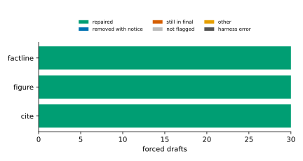

# EXP-2026-11-020 — Results

## 1. Headline

- **C-047 supported:** no flagged injected error reached a final answer — **0 of 90** forced drafts (one-sided 95% upper bound 3.3%).
- **C-048 supported, with a caveat:** **90/90** flagged drafts ended in an answer the checker accepts (Wilson 95% [0.96, 1.00]); none needed the strip-and-notice path. But repairs often shorten the answer silently: median final length 58% of the draft, under half in 30/90.
- **C-049 refuted:** the `unread` check flagged **0 of 20** surfaced-but-unread references (0/20 controls); it flagged 20/20 only once the listing was cleared from view. Predicted from the code before the run.
- **5c (model-judged, not checked by a person):** the second model marked **51 details unsupported in 50 Mylo answers** (1.02 per answer; 18/50 answers with at least one, Wilson [0.24, 0.50]) and 23 in 48 single-call answers; the checker flags **none of them** (model-judged recall 0/51, upper 0.07). Most are evaluative claims with no number (40/51), which the checker does not parse by design (O2). Pre-registered pass: 48 of 100 reader replies were cut at the token cap (Amendment 1 re-read them).

## 2. Results table

Generated by `code/analyse.py` into `tables/summary.md` (every row with its k,
n and interval); the rows that carry the claims:

<!-- BEGIN GENERATED TABLE -->
| part | group | metric | k / n | value | 95% interval |
|---|---|---|---|---|---|
| 5a | all three classes | still in the final answer (C-047) | 0 / 90 | 0.0 | upper 0.0327 (exact, one-sided) |
| 5a | all three classes | repaired (C-048) | 90 / 90 | 1.0 | [0.9591, 1.0] |
| 5a | cite / figure / factline | repaired | 30 / 30 each | 1.0 | [0.8865, 1.0] each |
| 5a | all | removed with the notice; not flagged; other | 0; 0; 0 / 90 | 0 | |
| 5a | all | exploratory: final under half the draft's length | 30 / 90 | 0.333 | [0.2445, 0.4358] |
| 5b | surfaced (C-049) | `k` flagged `unread` | 0 / 20 | 0.0 | [0.0, 0.1611] |
| 5b | read (control) | `k` flagged `unread` | 0 / 20 | 0.0 | [0.0, 0.1611] |
| 5b | cleared (exploratory) | `k` flagged `unread` | 20 / 20 | 1.0 | [0.8389, 1.0] |
<!-- END GENERATED TABLE -->

Repair cost (the instance model's calls after the forced draft, flagged
drafts): median 16.3 s and 5,873 tokens (means 17.3 s, 8,054); by class,
cite 14.9 s / 4,591, figure 15.1 s / 7,523, factline 18.3 s / 5,860 (medians).
The repair read something in 33 of 90 (figure 20/30, factline 13/30, cite
0/30). Per-class exploratory length kept (median final/draft): cite 0.62,
figure 0.56, factline 0.55; finals under half the draft: 7, 14, 9 of 30.

5c, from `data/metrics.json` (`5c` = pre-registered 6,000-token cap;
`5c_amend1` = failed rows re-read at 16,000). Model-judged (second model,
`default-model-2`), not checked by a person (calibration sheet unfilled).

| grading | arm | answers read | details | unsupported | per answer | answers with ≥1 (Wilson 95%) | checker flagged (recall, Wilson 95%) |
|---|---|---|---|---|---|---|---|
| 5c | Mylo (a) | 24 | 141 | 5 | 0.208 | 4/24 [0.067, 0.359] | 0/5 [0.0, 0.4345] |
| 5c | single call (b) | 28 | 178 | 4 | 0.143 | 4/28 [0.057, 0.315] | 0/4 [0.0, 0.4899] |
| 5c_amend1 | Mylo (a) | 50 | 601 | 51 | 1.02 | 18/50 [0.2414, 0.4986] | 0/51 [0.0, 0.07] |
| 5c_amend1 | single call (b) | 48 | 561 | 23 | 0.479 | 14/48 [0.1824, 0.4318] | 0/23 [0.0, 0.1431] |

Unsupported by kind (`5c_amend1`, unsupported / details): Mylo — claim
40/249, fact line 7/137, figure 2/30, sentence 2/185; single call — claim
12/243, sentence 8/183, figure 3/22, fact line 0/113. The checker flagged 0
details in all 100 texts (`checker_flags_on_text` 0 for both arms). Reader
failures: 48 at the 6,000 cap; 2 still failed at 16,000.

## 3. Figures



`figures/make_figures.py` — outcome per forced draft and class (5a), from
`data/metrics.csv`.

## 4. Interpretation

- **The loop does what C-047 and C-048 say, on the three error kinds the
  checker can see.** Every injected invented citation, invented figure and
  wrong fact line that the current checker flagged (all 90) was gone from the
  final answer, and every time the instance model's single repair produced
  text the checker accepted, so the strip-with-notice fallback never ran.
- **"Repaired" is weaker than it sounds.** The pre-registered category means
  "the checker accepts the repaired answer"; it does not mean the detail was
  corrected. Finals are a median 58% of the draft's length, and a third are
  under half: the model often drops the flagged sentence and more around it,
  with no notice to the person (the notice only accompanies the strip). One
  repair (figure-03) answered that it "could not retrieve" the project after
  its own `projects_get` call used a wrong argument name. A measure of what
  the repair keeps — not in any claim — is the follow-up.
- **The `unread` check, as built, does not cover O9's scenario.**
  `verify.seen_refs` treats a reference as seen when any visible function
  result returned its number, and a search listing returns the numbers of what
  it lists; in a personal thread earlier turns stay in view. So a reference
  that was only listed is never `unread`. The check fires only after the
  listing leaves view (20/20 in the `cleared` arm), and even then the loop
  posts the unread citation if the one repair keeps it (5b's scripted repair
  repeated the draft and the final answer kept it; Q-077).
- **5c: what reaches people is mostly unsupported judgement, not invented
  facts — and the checker sees none of it.** Of the 51 details the second
  model marked unsupported in Mylo's answers, 40 are claims with no number
  ("the best fit among the open grants is #6", "would strengthen this
  application", "collaborator search is currently turned off"); the rest
  include words the reader took from the question itself ("three papers",
  "PhD student") and a few genuine details (an agency named "National Science
  Foundation" not in the evidence). The checker parses fact lines and figures
  only, so a model-judged recall of 0/51 says O2 (claims with no number) is
  the gap that matters in practice, and O1/O3 (facts in a sentence, a fact
  line checked against the wrong item) are rare on these answers. Mylo's
  answers carry about twice as many unsupported details per answer as the
  single call's, because they make more recommendations; the reader's
  judgement of what counts as a "detail" has not been checked by a person.

## 5. Threats to validity

- 5a's errors are rule-built on round one's answers (written by round one's
  model); the repairs are tonight's instance model, which self-reports as a
  different model. The replayed evidence is byte-identical, but the replayed
  calls show the model `{"replay": i}` as their arguments, which a real turn
  never would; figure-03's wrong argument name may partly come from that.
- The forced drafts are only the classes the checker can flag; C-047 says
  nothing about details the checker misses (5c, O1–O3).
- 5b is scripted end to end (no model call); it tests the check's definition,
  not a model's behaviour.
- 5c is one model's reading of another's answers; the reader's own errors are
  unmeasured until the calibration sheet is filled. The reader marks evaluative statements and
  words echoed from the question as unsupported details, so its counts are an
  upper bound on factual errors; 48 of its 100 first replies were cut at the
  pre-registered token cap (a reasoning model's reasoning counts against it),
  so the pre-registered 5c rests on 52 answers, biased toward short evidence;
  the amended reading covers 98.

## 6. What surprised us

- No forced draft took the strip-with-notice path: one repair always sufficed
  for the checker. The checker's notice is therefore rarely what the person
  sees; what they see is a shorter answer.
- In 5c the checker flagged nothing in any of the 100 regenerated answers —
  not even a figure — while the reader disagreed with about one detail in ten
  of Mylo's claims (40/249).

## 7. Follow-ups

Copied to `../../OPEN_QUESTIONS.md`: Q-076 (`unread` treats a search listing
as reading), Q-077 (an `unread` citation that survives the repair is posted),
Q-080 (repairs shorten answers silently; measure what they keep), Q-081 (the 5c reader: calibrate it against the person's sheet before using its recall number).

## 8. Reproduction

```bash
R="docker compose run --rm --no-deps -T --user $(id -u):$(id -g) -e HOME=/tmp -e AGENT_PARALLEL_CALLS=0 -v $PWD/docs/research:/app/docs/research backend uv run --no-sync --project web/backend python"
E=docs/research/experiments/EXP-2026-11-020-agent-verifier-loop
python3 $E/code/sample_drafts.py
$R $E/code/unread.py
$R $E/code/forced_drafts.py --conc 3
export EVAL2_LLM_API_KEY=…   # the instance's LLM_API_KEY; never written down
X="-e EVAL2_LLM_BASE_URL=http://llm-tunnel:9090/v1 -e EVAL2_LLM_MODEL=default-model-2 -e EVAL2_LLM_API_KEY"
docker compose run --rm --no-deps -T $X … python $E/code/reader.py --conc 3
docker compose run --rm --no-deps -T $X … python $E/code/reader.py --conc 3 --max-tokens 16000 \
    --only-failed-in data/reader_runs.jsonl --out data/reader_runs_amend1.jsonl
python3 $E/code/analyse.py
python3 $E/figures/make_figures.py
```

## AMENDMENTS

Amendment 1 (PROTOCOL.md, during 5c): answers whose reader reply was cut at
the 6,000-token cap were re-read once with 16,000; both 5c gradings reported.
The exploratory 5a length measure was added to `analyse.py` after the 5a run
and is in no claim.

**2026-11-16 — the models named (round three, Phase 0).** This experiment ran on the relay's `default-model` (and, where used, `default-model-2`); confirmed by the maintainer on 2026-11-15: the instance model (`default-model`) in round two was Gemma 4 31B; the second model (`default-model-2`) was Qwen 3.8 27B, which was also round one's instance model. The self-reports recorded above are left as they were. Quantisation and server version of both: **unknown** — the relay does not expose them, and neither model was being served when this was written (see ISSUES.md). No number changes.

**2026-11-16 — the calibration sheet was not marked (round three, Phase 5).** The maintainer found it too long to mark reliably (ISSUES.md); Q-081 stays open and C-035's model-judged figure still has no person's check.
